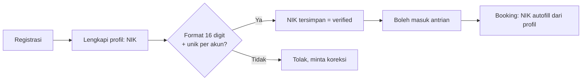

# Brainstorm #01 — Dampak ke SPEC

| | |
|---|---|
| **Status** | 🟡 DRAFT, menunggu review. `SPEC.md` (v0.1) **belum diubah**. |
| **Sumber** | Catatan brainstorming tim (2026-10-20/21) |
| **Tujuan** | Memetakan tiap poin ke dampaknya pada spec, menandai konflik dengan brief tender, dan menyiapkan daftar pertanyaan per narasumber. |

Legenda: ✅ Sudah searah dengan spec · 🔄 Mengubah/menambah spec · ⚠️ Konflik dengan brief tender · ❓ Perlu jawaban pihak lain

---

## 1. Pertanyaan ke Narasumber (siap kirim)

### 👤 Mas Nur
1. **Budget:** Berapa budget project ini? Apakah ada batas biaya infrastruktur/cloud untuk demo?
2. **User service:** Apakah sudah ada user service/SSO perusahaan yang bisa dipakai, atau kita bangun sendiri (registrasi, login, profil)?
3. **Dashboard management:** Brief menyebut back-office *out of scope*. Apakah kita tetap perlu dashboard (CRUD event, CRUD user, kelola stok)? Kalau ya, apakah dari sisi internal sudah ada sistem yang bisa kita integrasikan, atau kita bangun sendiri?
4. **Sistem stok:** Siapa yang boleh menambah stok dan kapan (lihat §3.7)?
5. **Penerbitan tiket:** Tiket diterbitkan langsung setelah bayar, atau pada waktu tertentu (mis. H-7)? Perlu dibedakan *e-ticket* dan *gate pass* (lihat §3.9)?
6. **Validasi NIK:** Siapa yang bertanggung jawab memverifikasi NIK (sistem, atau di lapangan)? Perlu integrasi layanan kependudukan?

### 👤 Bang Shadrach, Mas Aji, Cip, Hamzah
1. **Tech stack:** Apakah usulan di README §5 sesuai tech radar? Jika tidak, stack apa yang disetujui untuk BE, Web, dan Mobile?
2. **Standard development perusahaan:** Apa saja yang wajib (CI/CD, logging, struktur repo, dll.)?

---

## 2. Perubahan Scope

| # | Poin brainstorm | Dampak | Status |
|---|---|---|---|
| S-1 | Registrasi/login user | Dibutuhkan untuk notifikasi, payment, antrian, dan mencegah spam antrian. Menutup **D-05**: *login wajib*. `userKey` antrian = `userId`. | 🔄 ❓ |
| S-2 | CRUD user | Tambahan modul User Service (registrasi, login, profil). | 🔄 ❓ |
| S-3 | CRUD event | Tambahan modul Admin/Event. Brief menyebut ini **out of scope**, jadi perlu konfirmasi Mas Nur. | ⚠️ ❓ |
| S-4 | Dashboard management | Belum jelas cakupannya (internal atau kita bangun). Tunggu jawaban. | ❓ |

> **Catatan:** S-1 sampai S-4 menambah kerja signifikan untuk tim 5 orang. Usulan prioritas jika waktu terbatas: S-1 (MUST, minimal), S-2 dan S-3 (cukup API + seed data), S-4 (COULD).

---

## 3. Perubahan Perilaku Sistem

### 3.1 Status event "Open at 10:00" 🔄
- Tambah status event **`UPCOMING`** dengan `sale_opens_at`.
- Home menampilkan badge "Buka pukul 10:00" dan tombol dinonaktifkan sampai jam tersebut (ditambah countdown, opsional).
- Validasi di **server**: `POST /events/{id}/queue` ditolak (`409 SALE_NOT_OPEN`) sebelum `sale_opens_at`. Tidak cukup hanya disembunyikan di UI.
- Dampak ke FR-02/03: ada 4 status tampilan, bukan 2.
- ❓ Apakah waiting room dibuka sebelum jam buka (*pre-queue*, siapa cepat masuk antrian), atau hanya setelah jam buka? Ini memengaruhi fairness dan beban saat T+0.

### 3.2 "Your Queue" di Home 🔄
- Home menampilkan kartu **"Antrian Anda"** berisi antrian aktif milik user: posisi, event, dan tombol "Lanjutkan".
- Endpoint baru: `GET /me/active-session` → mengembalikan `{state: WAITING|BOOKING|PAYMENT, eventId, position?, expiresAt?}`.
- Karena sudah login (S-1), state tersimpan per `userId`, bukan hanya token di browser. Ini juga membuat user bisa lanjut dari perangkat lain.
- Memperkuat FR-10 dan memenuhi "Jangan PHP".

### 3.3 Waiting Room boleh ditinggalkan 🔄 ⚠️ perlu keputusan
- User boleh menutup waiting room dan kembali lewat "Your Queue".
- **Risiko yang perlu diputuskan:** jika user pergi lalu giliran tiba, slot terbuang selama TTL Booking.
- ❓ **Usulan:** posisi antrian tetap dipertahankan. Saat giliran tiba, user menerima email/notifikasi "Giliran Anda tiba". TTL Booking 5 menit mulai berjalan **sejak giliran tiba**, bukan sejak user membuka halaman.
- ❓ Apakah ada batas durasi meninggalkan antrian (mis. antrian hangus setelah 30 menit tidak aktif)? Tanpa batas ini, antrian bisa diisi "user hantu".

### 3.4 Auto-redirect ke Booking Screen ✅
Sesuai FR-08 dan wireframe 9.3. Jika user tidak sedang membuka waiting room, redirect terjadi saat ia membuka "Your Queue".

### 3.5 Status stok: "Hampir Habis" dan "Habis" 🔄

Brief hanya mengenal `AVAILABLE` dan `SOLD_OUT`. Brainstorm menambah `ALMOST_SOLD_OUT`.

| Status | Definisi dari brainstorm | Formulasi |
|---|---|---|
| **Hampir habis** | Kuota tiket < jumlah user yang sedang reserve (on process booking) | `available < jumlah_session_aktif` (atau `available < Σ qty yang sedang dibooking`) |
| **Habis (Sold Out)** | Setelah user yang reserve **berhasil menyelesaikan pembayaran** | `available = 0` **dan** tidak ada hold aktif |

- **Implikasi baik:** event tidak ditampilkan *Sold Out* selama masih ada hold yang bisa gagal bayar. Ini selaras dengan *Jangan PHP*.
- ❓ **Perlu diperjelas rumusnya.** "Kuota < user sedang reserve" bisa dibaca dua cara (jumlah **user** vs jumlah **tiket**). Usulan: pakai jumlah tiket yang sedang di-hold/dipilih (`Σ qty`), karena user bisa memesan 1–3 tiket.
- Status `ALMOST_SOLD_OUT` adalah label **tampilan**, bukan state yang membatasi pembelian. Sumbernya cache dengan TTL beberapa detik.
- Dampak ke §4/§5 SPEC: Admission Ticker perlu tahu stok yang tersisa agar tidak memanggil lebih banyak user daripada stok yang mungkin tersedia (lihat §3.6).

### 3.6 Limit tiket saat stok terbatas 🔄
- Detail Ticket Page membatasi qty: `maxQty = min(3, stok kategori, sisa kuota)`.
- Jika stok kategori sedikit (mis. tersisa 2) maka maksimum pilihan 2.
- Ini sudah tercakup FR-14. Tambahan: tampilkan label eksplisit "Tersisa X tiket, maksimal Y per pembelian".
- Race condition tetap ditangani validasi server (SPEC §5.3).

### 3.7 Sistem stok ❓
Pertanyaan di catatan: *"Sistem stok seperti apa? Bisa ditambahin stok kapan?"* Usulan model:

| Sumber perubahan stok | Efek | Siapa |
|---|---|---|
| Admin menambah/mengubah kuota kategori | `total_stock += n`, `available += n` | Admin (CRUD event, S-3) |
| Booking dibuat (hold) | `available -= qty` | Sistem |
| Hold expired / bayar gagal | `available += qty` | Sistem (Expiry Sweeper) |
| Pembayaran sukses | `available` tidak berubah, `sold += qty` | Sistem |
| Refund / pembatalan | ❓ Apakah stok kembali? | Perlu keputusan bisnis |

**Invarian yang dijaga:** `available + held + sold = total_stock`. Tambahkan kolom `held` dan `sold` agar status "Hampir Habis" dan "Habis" bisa dihitung langsung tanpa query agregat berat.
❓ Pertanyaan untuk Mas Nur: apakah stok boleh ditambah **saat penjualan berlangsung** (mis. rilis tiket batch kedua)? Jika ya, user di antrian yang sempat melihat "Sold Out" harus diberi tahu.

### 3.8 Time limit Booking 5 menit 🔄
- Timer **tetap berjalan** saat user keluar ke Home. User bisa lanjut lewat "Your Queue" selama TTL belum habis.
- Jika TTL habis: slot dilepas, user kembali ke Home, dan **harus antre ulang**. Ini sejalan dengan SPEC §5.5/BR-04.
- Perlu API untuk memulihkan sesi: `GET /me/active-session` (§3.2) mengembalikan `expiresAt` absolut dari server.
- UX: tampilkan pesan jelas "Waktu habis, silakan antre kembali" (NFR-01).

### 3.9 Payment 10 menit ✅
Sesuai BR-05/FR-21, tidak ada perubahan.

### 3.10 Notifikasi email 🔄 ⚠️

| # | Email (brainstorm) | Pemicu | Status |
|---|---|---|---|
| 1 | Selesaikan pembayaran | Booking dibuat (HELD), dengan pengingat sebelum TTL habis | 🔄 **Baru** |
| 2 | Pembayaran diterima | Callback sukses | 🔄 **Baru** |
| 3 | Ticket issued | Tiket diterbitkan | ✅ (FR-22) |

> ⚠️ Brief **FR-23** mewajibkan email **"pembayaran expired"**, tetapi daftar brainstorm tidak memuatnya. Usulan: **tetap pertahankan sebagai email #4** agar memenuhi FR-23.
> ❓ Apakah "Giliran Anda tiba" (§3.3) juga dikirim lewat email?

Dampak teknis: pengingat "selesaikan pembayaran" butuh *scheduled job* (mis. kirim di menit ke-5 dari 10). Reuse mekanisme outbox + Expiry Sweeper.

### 3.11 Penerbitan tiket vs gate pass ❓
- **Opsi A:** Tiket diterbitkan langsung setelah bayar. Sederhana dan sesuai FR-22.
- **Opsi B (usulan brainstorm):** Pisahkan:
  - **Ticket** = bukti pembelian/hak masuk, diterbitkan langsung setelah bayar.
  - **Gate Pass** = QR untuk masuk venue, diterbitkan pada waktu tertentu (mis. H-7) dan bisa dikaitkan dengan verifikasi NIK.
- Opsi B menambah *scheduled issuing job*, state baru (`TICKET_ISSUED` → `GATE_PASS_ISSUED`), dan email tambahan. Cocok bila ingin mencegah calo (tiket dijual ulang), tetapi memperbesar scope.
- ❓ Keputusan menunggu Mas Nur. Usulan awal: **Opsi A untuk MVP**, Opsi B ditulis sebagai *future work* di dokumentasi.

---

## 4. NIK ⚠️ (bagian paling berisiko)

Catatan brainstorm:
1. *"Booking screen NIK tidak perlu divalidasi (bisa divalidasi di luar journey, by system atau di lapangan)."*
2. *"NIK bisa autofill dari profil user kalau pernah diisi."*
3. *"Prompt user untuk verifikasi (validasi NIK) setelah registrasi atau sebelum masuk antrian."*

**Konflik dengan brief:**

| Brief | Brainstorm |
|---|---|
| FR-15 (MUST): sistem memvalidasi format NIK 16 digit dan mencegah penggunaan NIK yang sama melampaui 3 tiket | Tidak divalidasi di booking screen |
| FR-13 / BR-01 / BR-02: kuota 3 tiket **per NIK** | Kuota perlu dasar identitas yang tetap dipegang sistem |

**Cara mendamaikan (usulan):** pindahkan validasi dari *booking screen* ke *profil user*.

- **Format + keunikan** NIK divalidasi **sekali** saat melengkapi profil (bukan di tengah journey yang berpacu waktu). Ini tetap memenuhi semangat FR-15.
- **Booking screen** hanya menampilkan NIK dari profil (read-only/autofill), tanpa validasi berulang. Journey lebih cepat dan tidak mudah gagal.
- **Kuota 3/NIK tetap ditegakkan di server** menggunakan NIK profil, bukan input bebas di form. Ini juga mencegah user mengetik NIK berbeda tiap pembelian untuk menghindari batas.
- **Verifikasi tingkat lanjut** (cocok dengan data dukcapil, atau pengecekan di lapangan) berada di luar journey. Kasus ini terkait "gate pass" (§3.11).
- ❓ **Keputusan:** NIK dikumpulkan **saat registrasi** atau **sebelum masuk antrian** (lazy)? Usulan: **sebelum masuk antrian**. Registrasi tetap ringan, tetapi antrian hanya untuk user dengan NIK terisi. Cocok dengan poin "prevent spam antrian".
- ❓ **FR baru?** Pertanyaan di catatan: *"autofill pakai FR apa engga?"* Usulan: **ya**, tambahkan FR baru (lihat §5).

> **Dampak ke SPEC:** menutup **D-07** dan **D-08** dengan arah baru: NIK berasal dari profil, bukan dari form booking. Perlu konfirmasi bahwa menggeser validasi ke profil dapat diterima sebagai pemenuhan FR-13 dan FR-15.

---

## 5. Usulan Requirement Baru

> Penomoran sementara. ID final diberikan setelah review.

| ID (draft) | Requirement | Prioritas (usulan) | Berasal dari |
|---|---|---|---|
| FR-N01 | User dapat registrasi dan login | MUST | S-1 |
| FR-N02 | User dapat melengkapi profil termasuk NIK (validasi format + keunikan saat simpan) | MUST | §4 |
| FR-N03 | User wajib punya NIK terverifikasi sebelum masuk antrian | MUST | §4 |
| FR-N04 | Booking screen mengisi NIK otomatis dari profil | SHOULD | §4 |
| FR-N05 | Event berstatus `UPCOMING` menampilkan jam buka dan tidak bisa dibeli sebelum waktunya | MUST | §3.1 |
| FR-N06 | Home menampilkan "Your Queue" untuk melanjutkan antrian/booking/payment aktif | MUST | §3.2 |
| FR-N07 | Waiting room boleh ditinggalkan tanpa kehilangan posisi | MUST | §3.3 |
| FR-N08 | Status stok "Hampir Habis" ditampilkan di Home | SHOULD | §3.5 |
| FR-N09 | Sesi booking tetap berjalan (timer tidak berhenti) saat user keluar dari halaman | MUST | §3.8 |
| FR-N10 | Email "selesaikan pembayaran" dan "pembayaran diterima" | SHOULD | §3.10 |
| FR-N11 | CRUD event (admin) | ❓ | S-3 |
| FR-N12 | CRUD user (admin) | ❓ | S-2 |
| FR-N13 | Gate pass terpisah dari tiket | COULD / future | §3.11 |

---

## 6. Dampak ke Dokumen & Desain

| Bagian SPEC | Perlu diubah |
|---|---|
| §2 Glosarium | Tambah: Your Queue, UPCOMING, Gate Pass, Hampir Habis |
| §3 Arsitektur | Tambah modul **User/Auth** (dan **Admin** jika S-3/S-4 disetujui) |
| §4 Waiting Room | `userKey = userId`; kebijakan meninggalkan antrian; notifikasi "giliran tiba" |
| §5 Booking | NIK dari profil; TTL tetap berjalan; `held`/`sold` di kategori |
| §7 Email | Tambah 2–3 jenis email, scheduled reminder |
| §8 State | Tambah state `UPCOMING`/`ALMOST_SOLD_OUT` (event) dan opsional `GATE_PASS_ISSUED` |
| §9 Data Model | Tabel `users` (nik_hash, nik_verified_at), kolom `held`/`sold`, `events.sale_opens_at` |
| §10 API | `/auth/*`, `/me`, `/me/active-session`, endpoint admin |
| §14 | **D-05 tertutup** (login wajib). D-07/D-08 diperbarui (lihat §4). D-10 menunggu tech radar |
| §12 Pembagian kerja | Perlu penyesuaian: BE-1 ambil User/Auth, atau bagi ulang (scope bertambah) |

---

## 7. Pertanyaan Terbuka Baru (lanjutan dari D-01…D-13)

| ID | Pertanyaan | Usulan |
|---|---|---|
| D-14 | NIK dikumpulkan saat registrasi atau sebelum masuk antrian? | Sebelum masuk antrian |
| D-15 | Dasar penghitungan "Hampir Habis": jumlah user atau jumlah tiket? | Jumlah tiket yang sedang di-hold/dipilih |
| D-16 | Batas durasi antrian yang ditinggalkan | ❓ Mis. 30 menit tidak aktif → hangus |
| D-17 | Pre-queue sebelum jam buka? | ❓ |
| D-18 | Email "expired" (FR-23) tetap dikirim walau tidak ada di catatan brainstorm? | Ya |
| D-19 | Notifikasi "giliran tiba" (email/push) saat user tidak membuka waiting room | Email, push untuk mobile jika tersedia |
| D-20 | Stok boleh ditambah saat penjualan berlangsung? Refund mengembalikan stok? | ❓ Mas Nur |
| D-21 | Ticket dan gate pass: satu atau dua tahap? | Satu tahap (MVP) |
| D-22 | CRUD event/user dan dashboard dibangun atau pakai sistem internal? | ❓ Mas Nur |

---

## 8. Checklist Tindak Lanjut

- [ ] Kirim pertanyaan §1 ke Mas Nur dan tim tech radar
- [ ] Putuskan D-14 sampai D-22
- [ ] Konfirmasi bahwa validasi NIK di profil dapat memenuhi FR-13/FR-15 (§4)
- [ ] Setelah jawaban masuk, update `SPEC.md` ke v0.2 dan buat ADR
- [ ] Update `README.md` (tech stack, scope, pembagian tim)
- [ ] Simpan catatan brainstorm ini di `docs/ai/` sesuai aturan #5 brief
