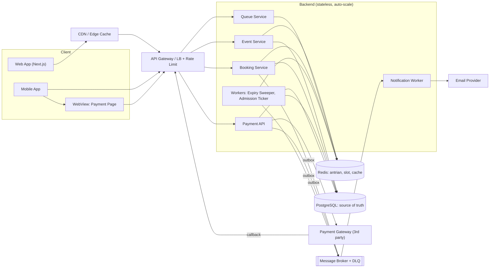
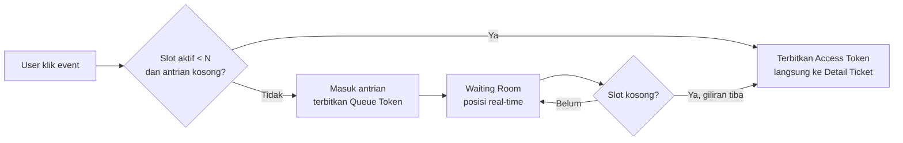
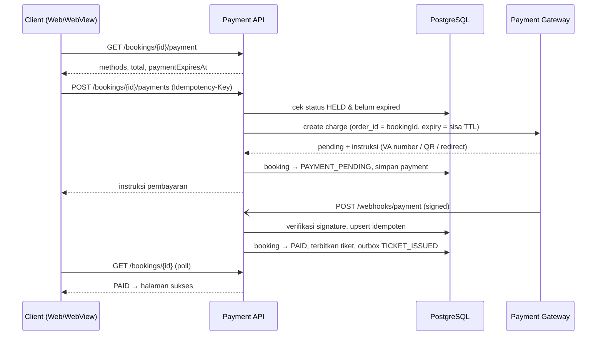
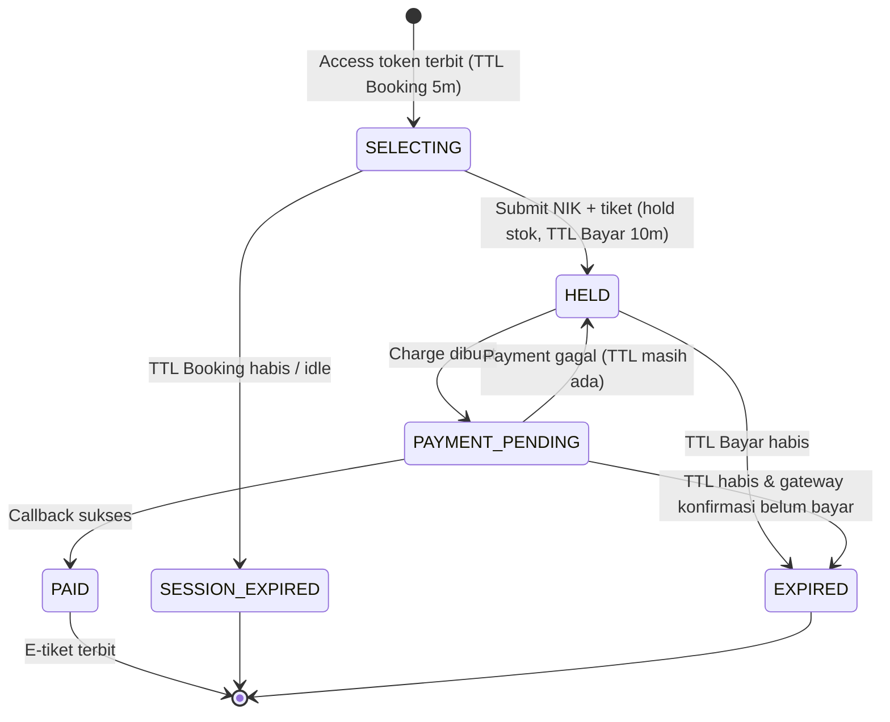
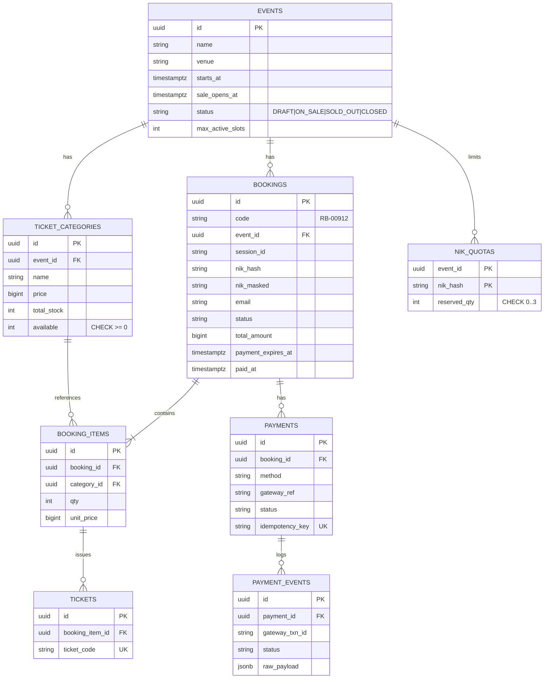
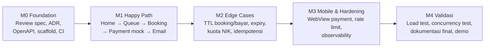

# Technical Specification — Rusuh Booking Tiket

| | |
|---|---|
| **Versi** | 0.1 (DRAFT) |
| **Status** | 🟡 Menunggu review — **jangan diimplementasikan dulu** |
| **Sumber** | Dokumen tender *Tender Rusuh Booking Ticket* (hal. 1–19) |
| **Tanggal** | 2026-10-20 |

> **Cara review:** Setiap bagian bertanda ❓ adalah asumsi atau usulan yang perlu dikonfirmasi. Daftar lengkap keputusan yang menunggu jawaban tersedia di [§14 Open Questions](#14-open-questions--keputusan-yang-perlu-direview). Komentar bisa ditulis langsung di bawah item terkait dengan format `> 💬 [nama]: ...`.

---

## Daftar Isi

1. [Ringkasan](#1-ringkasan)
2. [Glosarium](#2-glosarium)
3. [Arsitektur](#3-arsitektur)
4. [Desain Virtual Waiting Room](#4-desain-virtual-waiting-room)
5. [Desain Booking & Stok](#5-desain-booking--stok)
6. [Desain Payment](#6-desain-payment)
7. [Notifikasi Email](#7-notifikasi-email)
8. [State Machine](#8-state-machine)
9. [Data Model](#9-data-model)
10. [API Contract](#10-api-contract)
11. [Non-Functional Requirement → Desain](#11-non-functional-requirement--desain)
12. [Pembagian Kerja & Milestone](#12-pembagian-kerja--milestone)
13. [Strategi Testing](#13-strategi-testing)
14. [Open Questions / Keputusan yang Perlu Direview](#14-open-questions--keputusan-yang-perlu-direview)
15. [Traceability Matrix](#15-traceability-matrix)

---

## 1. Ringkasan

Rusuh Booking Tiket adalah sistem penjualan tiket konser online dengan empat halaman: **Home → Waiting Room → Detail Ticket → Payment**. Tantangan utamanya bukan fitur, melainkan menjaga sistem tetap **stabil, adil, dan konsisten** saat permintaan jauh melebihi stok tiket.

**Tiga masalah inti yang dipecahkan spesifikasi ini:**

| # | Masalah | Pendekatan |
|---|---|---|
| 1 | Flash crowd membebani sistem inti | **Waiting room + admission control.** Hanya N user aktif per event yang boleh masuk ke booking. |
| 2 | Oversell & borong tiket | **Atomic conditional update** untuk stok dan kuota NIK dalam satu transaksi DB. |
| 3 | "PHP": user kehilangan sesi di tengah jalan | **Server-authoritative TTL**, token persisten, payment idempoten, dan proses async yang tidak membatalkan transaksi. |

---

## 2. Glosarium

| Istilah | Definisi |
|---|---|
| **Queue Token** | Token persisten yang diberikan saat user masuk antrian. Dipakai untuk menjaga posisi meski halaman di-refresh. |
| **Access Token / Slot** | Token berumur pendek yang memberi hak membuka Detail Ticket Page untuk satu event. |
| **Admission** | Proses mempromosikan user dari antrian menjadi pemegang slot aktif. |
| **Max Active Slots (N)** | Jumlah maksimum sesi booking aktif bersamaan per event. Nilainya bisa dikonfigurasi. |
| **TTL Booking** | 5 menit sejak access token diterbitkan (BR-03). |
| **TTL Pembayaran** | 10 menit sejak booking/hold dibuat (BR-05). |
| **Hold** | Reservasi stok sementara saat user lanjut ke pembayaran. |
| **NIK** | Nomor Induk Kependudukan 16 digit, dasar kuota 3 tiket/event. |

---

## 3. Arsitektur

### 3.1 Diagram Komponen



> ❓ **D-01:** Pilih *modular monolith* (satu deployable, modul terpisah) atau microservices. **Usulan: modular monolith.** Dengan 2 BE dev, overhead operasional microservices tidak sepadan. Batas antar modul tetap dijaga agar bisa dipecah nanti. Komponen di atas adalah *modul logis*.

### 3.2 Prinsip Desain

- **Layer stateless** (API) di-scale horizontal (NFR-03). Semua state berada di Redis/PostgreSQL.
- **Hot path dilindungi waiting room.** Booking Service hanya menerima traffic dari pemegang access token, sehingga beban DB terbatas sebesar N user aktif.
- **Read-heavy path di-cache.** Daftar event disajikan dari Redis/CDN dengan TTL pendek (mis. 2–5 detik), dan status stok bersifat *eventually consistent* untuk tampilan.
- **Write-critical path konsisten.** Stok dan kuota hanya diubah lewat transaksi DB atomik.
- **Side effect dibuat async.** Email dan event analytics dikirim lewat outbox → broker → worker dengan retry + DLQ (NFR-10).

---

## 4. Desain Virtual Waiting Room

### 4.1 Konsep



### 4.2 Struktur Data (Redis)

| Key | Tipe | Isi |
|---|---|---|
| `q:{eventId}:seq` | String (INCR) | Counter nomor antrian monoton |
| `q:{eventId}:waiting` | Sorted Set | member = `queueId`, score = nomor urut (FCFS, NFR-05) |
| `q:{eventId}:active` | Sorted Set | member = `sessionId`, score = `expiresAt` |
| `q:{eventId}:ticket:{queueId}` | Hash | `userKey`, `status` (WAITING/ADMITTED), `accessToken`, `joinedAt` |
| `q:{eventId}:user:{userKey}` | String | `queueId` aktif, untuk mencegah satu user antri berkali-kali (BR-07) |
| `q:{eventId}:stats` | Hash | laju admission per menit (untuk ETA, FR-09) |

### 4.3 Alur

1. **Join** — `POST /events/{id}/queue`
   - Jika user sudah punya entry aktif, kembalikan entry yang sama (**idempoten**, FR-10).
   - Jika `|active| < N` **dan** `|waiting| = 0`, langsung terbitkan access token (FR-05).
   - Selain itu, `ZADD waiting` dengan score dari `INCR seq`, lalu kembalikan queue token (FR-04).
2. **Posisi** — posisi = `ZRANK(waiting, queueId) + 1` (FR-06), dengan kompleksitas O(log n).
3. **Admission Ticker** (worker, tiap ~1 detik, dengan *distributed lock* per event agar hanya satu instance yang berjalan):
   - Hapus slot kedaluwarsa: `ZREMRANGEBYSCORE active -inf now`.
   - `free = N - |active|`, lalu pop `free` entry terdepan dari `waiting` (`ZPOPMIN`), tandai ADMITTED, dan terbitkan access token.
   - Semua langkah dijalankan dalam **Lua script** agar atomik.
4. **Update ke klien** (FR-07, FR-08) — ❓ **D-02**:
   - **Usulan: polling adaptif** (`GET /queue/status`) dengan interval dari server (`retryAfterMs`, mis. 2–10 dtk + jitter). Polling stateless, mudah di-scale, ramah CDN/LB, dan andal di jaringan seluler.
   - Alternatif: SSE/WebSocket. Lebih real-time, tetapi jutaan koneksi persisten saat flash crowd berisiko tinggi.
5. **Slot dilepas** (BR-04, BR-06) saat booking selesai, TTL habis, atau payment expired. Session dihapus dari `active`, lalu ticker mengisi slot pada tick berikutnya.

### 4.4 Persistensi Posisi saat Refresh (FR-10)

- Queue token (JWT bertanda tangan, berisi `eventId`, `queueId`, `userKey`) disimpan di **cookie HttpOnly + localStorage** (web) dan secure storage (mobile).
- Posisi dihitung ulang dari Redis berdasarkan `queueId`, **bukan** dari session browser.
- `userKey` = user ID (jika login) ❓ atau device fingerprint + IP (jika guest). Lihat **D-05**.

### 4.5 ETA (FR-09, COULD)

`eta = posisi / avgAdmissionRatePerMinute` (moving average 5 menit). Tampilkan sebagai rentang ("± 4 menit").

### 4.6 Ketahanan

- Jika Redis antrian down, Home tetap tampil dari cache dan tombol "Beli" menampilkan pesan *"Antrian sedang sibuk, coba beberapa saat lagi"*, bukan error 500 (NFR-01).
- Redis dijalankan dengan replikasi + AOF agar posisi antrian tidak hilang.

---

## 5. Desain Booking & Stok

### 5.1 Access Token & TTL Booking

- Diterbitkan saat admission. JWT berisi `sessionId`, `eventId`, `userKey`, `exp = now + 5 menit` (BR-03).
- **Server-authoritative** (FR-19): `expiresAt` disimpan di Redis (`active` ZSET) dan dikirim ke klien sebagai **timestamp absolut**. Klien menghitung countdown dari `expiresAt - serverNow`, dengan offset jam dikoreksi lewat header `Date`.
- Setiap request ke Booking Service memvalidasi token **dan** keberadaan session di `active`. Akses ke Detail/Payment tanpa token akan ditolak (NFR-07).

### 5.2 Validasi NIK (FR-13, FR-15)

- Format: tepat 16 digit numerik. ❓ Validasi struktur tambahan (kode wilayah 6 digit + tanggal lahir 6 digit) diusulkan sebagai *soft check*.
- **Privasi (UU PDP):** NIK **tidak disimpan plaintext**. Yang disimpan:
  - `nik_hash = HMAC-SHA256(secret, nik)` untuk keperluan kuota/lookup.
  - `nik_masked = 3171********1234` untuk tampilan e-tiket.
  - ❓ **D-07:** Apakah perlu `nik_encrypted` (AES-GCM) untuk verifikasi di venue?

### 5.3 Pembuatan Booking (Hold) — Atomik

`POST /bookings` dengan `Idempotency-Key`. Semua langkah berikut berjalan dalam **satu transaksi PostgreSQL**:

```sql
BEGIN;

-- 1. Kuota NIK (BR-01, BR-02): upsert + guard ≤ 3
INSERT INTO nik_quotas (event_id, nik_hash, reserved_qty)
VALUES (:event, :nik_hash, :qty)
ON CONFLICT (event_id, nik_hash)
DO UPDATE SET reserved_qty = nik_quotas.reserved_qty + EXCLUDED.reserved_qty
WHERE nik_quotas.reserved_qty + EXCLUDED.reserved_qty <= 3
RETURNING reserved_qty;          -- 0 rows → QUOTA_EXCEEDED

-- 2. Stok per kategori (NFR-04): conditional decrement, tanpa oversell
UPDATE ticket_categories
SET available = available - :qty
WHERE id = :category_id AND available >= :qty
RETURNING available;             -- 0 rows → OUT_OF_STOCK (rollback)

-- 3. Buat booking status HELD, payment_expires_at = now() + 10 min
INSERT INTO bookings (...) VALUES (...);
INSERT INTO booking_items (...) VALUES (...);

-- 4. Outbox event
INSERT INTO outbox (type, payload) VALUES ('BOOKING_HELD', ...);

COMMIT;
```

- Constraint `CHECK (available >= 0)` dan `CHECK (reserved_qty BETWEEN 0 AND 3)` menjadi **jaring pengaman terakhir**.
- Multi-kategori diproses dengan urutan `category_id` ascending untuk menghindari deadlock.
- Karena hanya N user aktif per event yang bisa mencapai endpoint ini, kontensi row bersifat terbatas.

> ❓ **D-03:** Stok di **PostgreSQL** (usulan, konsistensi kuat, sederhana, mudah diaudit) vs **Redis Lua atomic counter** (lebih cepat, tetapi butuh sinkronisasi ke DB dan berisiko drift). **Usulan: PostgreSQL**, karena waiting room sudah membatasi konkurensi. Redis hanya dipakai untuk *cache tampilan* stok.

### 5.4 Validasi di Sisi Klien (FR-14)

Tombol `+` dinonaktifkan jika: total ≥ 3, qty ≥ stok kategori, atau `totalQty + nikUsedQty ≥ 3`. Endpoint `GET /events/{id}/quota?nik=` mengembalikan sisa kuota NIK. **Validasi server tetap otoritatif.**

### 5.5 Booking Timeout (FR-17, FR-18, BR-04)

- **Interpretasi** ❓ **D-04**: TTL Booking (5 menit) berlaku selama user di Detail Ticket Page. Setelah hold dibuat, TTL Booking **digantikan** oleh TTL Pembayaran (10 menit sejak hold). Total maksimum ≈ 5 + 10 menit.
- Saat TTL Booking habis tanpa hold, session dihapus dari `active`, slot diberikan ke antrian berikutnya, dan klien menerima `410 SESSION_EXPIRED` lalu diarahkan ke Home dengan notifikasi.

### 5.6 Pelepasan Hold (Expiry Sweeper)

Worker berjalan tiap ~5 detik:

```sql
SELECT id FROM bookings
WHERE status IN ('HELD','PAYMENT_PENDING') AND payment_expires_at < now()
ORDER BY payment_expires_at
LIMIT 100
FOR UPDATE SKIP LOCKED;
```

Untuk setiap booking: status → `EXPIRED`, stok dikembalikan (`available += qty`), `nik_quotas.reserved_qty -= qty`, outbox `BOOKING_EXPIRED` (→ email), lalu slot dilepas. `SKIP LOCKED` membuat banyak instance worker aman berjalan paralel.

**Lazy check:** setiap read booking juga mengecek `payment_expires_at`, sehingga klien tidak pernah melihat status basi.

---

## 6. Desain Payment

### 6.1 Reusable Web Payment Page (FR-24, NFR-08)

- Route web: `/pay/{bookingId}`. Halaman yang **sama persis** dipakai di browser dan di dalam WebView mobile.
- Autentikasi: **payment token** sekali pakai berumur pendek (scope = `bookingId`), dikirim via query/fragment, lalu ditukar menjadi cookie session. Token tidak boleh disimpan di URL history setelah ditukar.
- Mobile membuka WebView ke URL tersebut. Hasil dikembalikan ke app melalui:
  1. **Redirect** ke `rusuh://payment/result?bookingId=...&status=...` (deep link), dan/atau
  2. **JS bridge** (`postMessage`) jika WebView mendukung.
- Halaman mendeteksi mode embedded (`?embed=1`) untuk menyembunyikan header/footer web.
- Setelah hasil diterima, mobile **selalu re-fetch** `GET /bookings/{id}` sebagai sumber kebenaran.

### 6.2 Alur Charge



### 6.3 Idempotensi (FR-25)

| Titik | Mekanisme |
|---|---|
| `POST /bookings` & `POST /payments` | Header `Idempotency-Key` (UUID dari klien). Tabel `idempotency_keys` menyimpan hash request + response selama 24 jam. |
| Webhook gateway | Unique constraint `(gateway, gateway_txn_id, status)` di `payment_events`. Duplikat → `200 OK` tanpa efek. |
| Transisi status | `UPDATE bookings SET status='PAID' WHERE id=:id AND status IN ('HELD','PAYMENT_PENDING')`. Transisi ilegal diabaikan. |
| Charge ke gateway | `order_id = bookingId` sehingga gateway menolak charge ganda. |

### 6.4 Edge Case Kritis ❓ D-06

| Kasus | Usulan penanganan |
|---|---|
| User sudah bayar, tetapi callback datang **setelah** TTL habis | Expiry sweeper **wajib cek status ke gateway** untuk booking `PAYMENT_PENDING` sebelum expire. Jika ternyata `settled`, booking diproses sebagai PAID (*Jangan PHP*). |
| Callback sukses datang setelah booking sudah `EXPIRED` & stok sudah dilepas | Coba re-hold stok. Jika stok tersedia, tiket diterbitkan; jika tidak, lakukan **auto-refund** + email permintaan maaf. Kasus ini dicatat sebagai metrik. |
| Expiry gateway | Charge dibuat dengan `expiry = paymentExpiresAt` agar VA/QR tidak bisa dibayar setelah TTL. Ini menjadi pencegahan utama untuk dua kasus di atas. |
| Callback `fail` | Booking tetap `HELD` selama TTL masih ada, sehingga user bisa mencoba metode lain. |
| User menutup tab | Tidak ada efek. Status tetap di server dan user bisa kembali lewat link di email/riwayat. |

---

## 7. Notifikasi Email

| Trigger | Email | Requirement |
|---|---|---|
| `TICKET_ISSUED` | E-tiket (kode tiket + QR, detail event, NIK masked) | FR-22 |
| `BOOKING_EXPIRED` | "Pembayaran expired, booking dibatalkan" | FR-23 |

- **Transactional outbox:** event ditulis dalam transaksi yang sama dengan perubahan status, lalu relay mempublikasikannya ke broker.
- Notification worker: retry exponential backoff (mis. 5x: 10 dtk → 30 menit), lalu masuk **DLQ** + alert (NFR-10).
- Kegagalan email **tidak pernah** mengubah status booking. E-tiket juga selalu bisa diakses di halaman sukses / `GET /bookings/{id}/tickets`.

---

## 8. State Machine

### 8.1 Booking



> `SELECTING` dan `SESSION_EXPIRED` hanya hidup di Redis (session). Status mulai `HELD` dipersist di PostgreSQL.

### 8.2 Pemetaan ke State Tiket di Brief (hal. 14)

| Brief | Spec |
|---|---|
| Available | `ticket_categories.available` |
| Selecting | Session `SELECTING` (stok belum dikunci) |
| Held | Booking `HELD` / `PAYMENT_PENDING` |
| Sold | Booking `PAID` + record `tickets` |

---

## 9. Data Model



Tabel pendukung: `outbox`, `idempotency_keys`, `users` (jika login, lihat D-05).

> Harga disimpan dalam **rupiah integer (bigint)**, bukan float.
> `nik_quotas.reserved_qty` menghitung booking `HELD` + `PAYMENT_PENDING` + `PAID` (BR-02 "termasuk booking lain yang masih aktif").

---

## 10. API Contract

Base path: `/api/v1` · Format REST/JSON (NFR-08) · Spesifikasi lengkap akan ditulis sebagai **OpenAPI 3.1** (`docs/openapi.yaml`) setelah review.

### 10.1 Endpoint

| # | Method & Path | Auth | Fungsi | FR |
|---|---|---|---|---|
| 1 | `GET /events` | Public (cached) | Daftar event + status (`AVAILABLE`/`SOLD_OUT`/`NOT_STARTED`) | FR-01–03 |
| 2 | `GET /events/{id}` | Public (cached) | Detail event | FR-11 |
| 3 | `POST /events/{id}/queue` | User/guest | Masuk antrian. Response `WAITING` + queueToken **atau** `ADMITTED` + accessToken | FR-04, 05 |
| 4 | `GET /queue/status` | Queue token | `{status, position, etaSeconds, retryAfterMs, accessToken?}` | FR-06–10 |
| 5 | `GET /events/{id}/categories` | Access token | Kategori, harga, stok, `bookingExpiresAt` | FR-11, 12, 17 |
| 6 | `GET /events/{id}/quota?nik=` | Access token | Sisa kuota NIK (`remaining: 0..3`) | FR-14 |
| 7 | `POST /bookings` | Access token + Idempotency-Key | Buat hold | FR-13–16 |
| 8 | `GET /bookings/{id}` | Owner / payment token | Status booking + `paymentExpiresAt` | FR-21 |
| 9 | `GET /bookings/{id}/payment` | Payment token | Metode, total, sisa waktu | FR-20, 21 |
| 10 | `POST /bookings/{id}/payments` | Payment token + Idempotency-Key | Buat charge | FR-20, 24 |
| 11 | `POST /webhooks/payment` | Signature gateway | Callback status | FR-25 |
| 12 | `GET /bookings/{id}/tickets` | Owner | E-tiket | FR-22 |
| 13 | `DELETE /sessions/current` | Access token | User keluar sukarela → slot dilepas lebih cepat | BR-04 |

### 10.2 Contoh Request/Response

**`POST /events/{id}/queue`**
```json
// 200 — antrian penuh
{ "status": "WAITING", "queueToken": "eyJ...", "position": 1248, "etaSeconds": 240, "retryAfterMs": 3000 }

// 200 — langsung masuk
{ "status": "ADMITTED", "accessToken": "eyJ...", "bookingExpiresAt": "2026-12-01T10:05:00Z" }
```

**`POST /bookings`**
```json
// Request
{
  "nik": "3171xxxxxxxxxxxx",
  "email": "user@mail.com",
  "items": [ { "categoryId": "vip", "qty": 1 } ]
}

// 201
{
  "bookingId": "b9c...",
  "code": "RB-00912",
  "status": "HELD",
  "totalAmount": 1500000,
  "paymentExpiresAt": "2026-12-01T10:15:00Z",
  "paymentUrl": "https://rusuh.id/pay/b9c...?pt=..."
}
```

### 10.3 Format Error Standar

```json
{
  "error": {
    "code": "QUOTA_EXCEEDED",
    "message": "NIK ini sudah mencapai batas 3 tiket untuk event ini.",
    "details": { "remaining": 0 },
    "traceId": "a1b2c3"
  }
}
```

| HTTP | Code | Kapan |
|---|---|---|
| 400 | `INVALID_NIK`, `INVALID_QTY` | Format salah, qty > 3 |
| 401 | `TOKEN_INVALID` | Token tidak ada / tidak valid (bypass antrian) |
| 409 | `OUT_OF_STOCK`, `QUOTA_EXCEEDED`, `ALREADY_IN_QUEUE` | Konflik bisnis |
| 410 | `SESSION_EXPIRED`, `BOOKING_EXPIRED` | TTL habis |
| 429 | `RATE_LIMITED` | Rate limit (dengan header `Retry-After`) |
| 503 | `QUEUE_BUSY` | Degradasi terkendali |

> Pesan error ditulis dalam **bahasa yang ramah user** (NFR-01). Klien memetakan `code` ke UI, bukan menampilkan `message` mentah.

---

## 11. Non-Functional Requirement → Desain

| ID | Kategori | Target | Cara memenuhi | Cara verifikasi |
|---|---|---|---|---|
| NFR-01 | Availability/UX | Tidak crash di beban puncak | Waiting room sebagai throttle, cache Home, degradasi graceful (503 ramah + retry) | Load test spike |
| NFR-02 | Reliability | Session & hold bertahan sepanjang TTL | TTL server-side, token persisten, cek gateway sebelum expire | E2E: refresh, kill pod saat booking |
| NFR-03 | Scalability | Auto-scale | API stateless, HPA berbasis CPU/RPS ❓ | Load test |
| NFR-04 | Consistency | 0 oversell | Conditional UPDATE + CHECK constraint | Test konkurensi (1000 request paralel, stok 10) |
| NFR-05 | Fairness | FCFS | Sorted set dengan sequence monoton, satu entry per user | Unit test + load test urutan admission |
| NFR-06 | Performance | p95 < 1 dtk (posisi antrian & home) | Redis O(log n), cache CDN, polling ringan | k6 threshold `p(95)<1000` |
| NFR-07 | Security | Tidak bisa bypass antrian | JWT + cek `active` set, rate limit, HTTPS, signature webhook, NIK di-hash, data kartu tidak pernah menyentuh server kita (gateway PCI-DSS) | Test negatif (akses tanpa token) |
| NFR-08 | Portability | API platform-agnostic | REST/JSON + OpenAPI, payment page reusable | Mobile memakai API yang sama |
| NFR-09 | Observability | Metrik real-time | Prometheus + Grafana ❓: `queue_length`, `admission_rate`, `active_slots`, `booking_conversion_rate`, `booking_expired_rate`, `payment_success_rate`, `oversell_guard_hits`; log terstruktur + `traceId` | Dashboard demo |
| NFR-10 | Resilience | Email gagal ≠ transaksi batal | Outbox + retry + DLQ | Test: matikan SMTP, transaksi tetap PAID |

---

## 12. Pembagian Kerja & Milestone

### 12.1 Ownership (usulan ❓)

| Anggota | Area | Deliverable utama |
|---|---|---|
| **BE-1** | Queue & Admission, Event Service | Endpoint #1–4, Admission Ticker, Redis Lua scripts, metrik antrian |
| **BE-2** | Booking, Payment, Notification | Endpoint #5–13, Expiry Sweeper, outbox/worker email, integrasi gateway |
| **FE-1 (Web)** | Home, Waiting Room, Design System | Halaman Home & Waiting Room, polling adaptif, komponen UI bersama |
| **FE-2 (Web)** | Detail Ticket, Payment Page (reusable), Status page | Form NIK/kategori + countdown, `/pay/{id}` dengan mode embed |
| **Mobile** | Mobile App | Home, Waiting Room (native), Detail Ticket, Payment via WebView + deep link handling |

Tanggung jawab bersama: OpenAPI contract (disepakati **di awal**, lalu FE memakai mock server), docker-compose, CI, dokumentasi.

### 12.2 Milestone (usulan)



> ❓ Durasi tiap milestone menunggu informasi timeline assessment.

---

## 13. Strategi Testing

| Level | Fokus | Tools (usulan) |
|---|---|---|
| Unit | Validasi NIK, kalkulasi kuota, transisi state, ETA | Go test / Jest |
| Integration | Transaksi hold, expiry sweeper, webhook idempoten (DB & Redis asli) | Testcontainers |
| **Concurrency** | **N request paralel ke stok terbatas → `sold ≤ stock`**; NIK sama dari banyak sesi → total ≤ 3 | Custom harness / k6 |
| Contract | Respons API sesuai OpenAPI | Schemathesis / Dredd |
| E2E Web | Seluruh journey + refresh di setiap halaman + timeout | Playwright |
| E2E Mobile | Journey + WebView payment + deep link kembali | Flutter integration test / Maestro |
| Load | Spike 0 → X user dalam 10 detik, verifikasi p95 & tidak ada 5xx | k6 |
| Chaos (light) | Matikan email worker / restart pod API saat booking | Docker Compose |

**Skenario wajib (acceptance):**
1. 10.000 user join bersamaan untuk stok 100 tiket → tidak ada oversell, urutan admission FCFS.
2. Refresh di Waiting Room → posisi tetap sama.
3. Idle 5 menit di Detail → sesi berakhir, slot pindah ke antrian berikutnya.
4. Tidak bayar 10 menit → booking expired, stok kembali, email expired terkirim.
5. Webhook sukses dikirim 3x → tiket terbit 1x, email 1x.
6. NIK sama dari 2 device, masing-masing 2 tiket → request kedua ditolak.
7. SMTP mati → booking tetap PAID, email terkirim setelah SMTP pulih.
8. Akses `/events/{id}/categories` tanpa token → 401.

---

## 14. Open Questions / Keputusan yang Perlu Direview

| ID | Pertanyaan | Opsi | Usulan |
|---|---|---|---|
| **D-01** | Arsitektur deploy | Modular monolith / Microservices | Modular monolith |
| **D-02** | Mekanisme update posisi antrian | Polling adaptif / SSE / WebSocket | Polling adaptif |
| **D-03** | Lokasi atomic stok | PostgreSQL conditional update / Redis Lua | PostgreSQL |
| **D-04** | Relasi TTL Booking (5m) & TTL Bayar (10m) | Berurutan (maks. 15m) / Paralel (10m mencakup 5m) | Berurutan |
| **D-05** | Wajib login? (wireframe menampilkan tombol "Login", asumsi brief menyebut "customer memiliki akun/identitas") | Login wajib (email OTP) / Guest + email | ❓ Butuh keputusan. Berdampak pada `userKey` antrian & BR-07 |
| **D-06** | Penanganan pembayaran terlambat | Cek gateway sebelum expire + auto-refund / Abaikan | Cek gateway + auto-refund |
| **D-07** | Penyimpanan NIK | Hash + masked saja / + encrypted | Hash + masked |
| **D-08** | ⚠️ **Konflik brief:** FR-13 *"jika NIK tidak tersedia, tidak dapat melanjutkan"* vs BR-01 *"Bila NIK tidak digunakan, kuota 3 dihitung per sesi pembelian"* | NIK wajib / NIK opsional + fallback kuota per sesi | **NIK wajib** (FR-13 berprioritas MUST); kuota per sesi tetap ditegakkan sebagai lapisan tambahan |
| **D-09** | Nilai N (max active slots) per event | Statis per event / Dinamis berdasarkan stok sisa & laju | Statis + bisa diubah via config. Saat stok habis, antrian ditutup dan semua yang menunggu diberi info "Sold Out" |
| **D-10** | Tech stack sesuai tech radar perusahaan | Lihat README §5 | Menunggu dokumen tech radar |
| **D-11** | Payment gateway | Midtrans sandbox / Xendit sandbox / Mock internal | Mock internal (fokus assessment) + adapter interface agar bisa diganti |
| **D-12** | Deployment target demo | Lokal (Docker Compose) / Cloud (GKE/Cloud Run) | Docker Compose; cloud opsional |
| **D-13** | Saat stok event habis, user di antrian | Dibiarkan menunggu (siapa tahu ada release) / Diberi tahu sold out | Tampilkan "Tiket habis, Anda tetap di antrian jika ada tiket yang dilepas" + opsi keluar (jujur = *Jangan PHP*) |

---

## 15. Traceability Matrix

| Req | Ringkas | Desain (§) | API (#) | Test |
|---|---|---|---|---|
| FR-01 | Daftar event | 3.2 | 1 | E2E |
| FR-02/03 | Status available/sold out | 3.2 | 1 | E2E |
| FR-04/05 | Redirect antrian / langsung | 4.3 | 3 | Integration |
| FR-06 | Posisi antrian | 4.3 | 4 | Unit |
| FR-07/08 | Update otomatis & auto-redirect | 4.3 | 4 | E2E |
| FR-09 | ETA (COULD) | 4.5 | 4 | Unit |
| FR-10 | Konsisten saat refresh | 4.4 | 3, 4 | E2E skenario 2 |
| FR-11/12 | Kategori, harga, stok | 5 | 5 | E2E |
| FR-13/15 | Limit 3 per NIK, validasi format | 5.2, 5.3 | 6, 7 | Concurrency skenario 6 |
| FR-14 | Disable qty invalid | 5.4 | 6 | E2E |
| FR-16 | Hold stok | 5.3 | 7 | Concurrency skenario 1 |
| FR-17/18/19 | TTL booking server-side | 5.1, 5.5 | 5 | E2E skenario 3 |
| FR-20 | Pilih metode bayar | 6.2 | 9, 10 | E2E |
| FR-21 | Countdown 10 menit | 6.2 | 8, 9 | E2E |
| FR-22 | Email e-tiket | 7 | 12 | Integration |
| FR-23 | Expired → batal, email, lepas stok | 5.6, 7 | — | E2E skenario 4 |
| FR-24 | API shared web & mobile | 6.1 | 8–10 | E2E mobile |
| FR-25 | Callback idempoten | 6.3 | 11 | Integration skenario 5 |
| BR-01–08 | Business rules | 5, 6, 8 | — | Lihat di atas |
| NFR-01–10 | Non-functional | 11 | — | Lihat §11 |

---

*Dokumen ini adalah draft untuk direview. Setelah §14 dijawab, keputusan final dicatat sebagai ADR di `docs/adr/` dan versi dokumen dinaikkan ke v1.0.*
